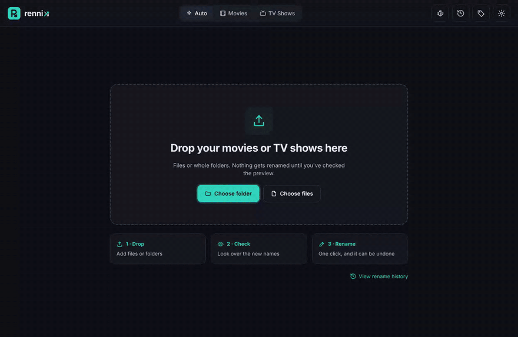
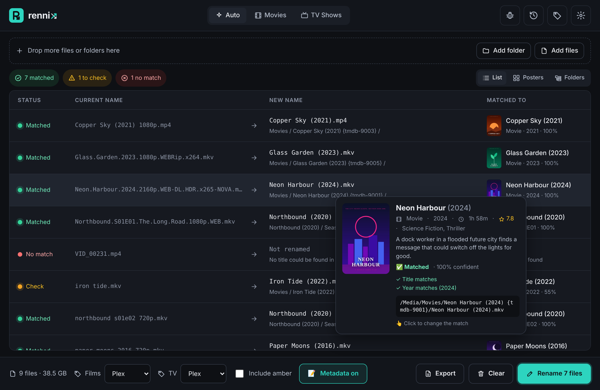
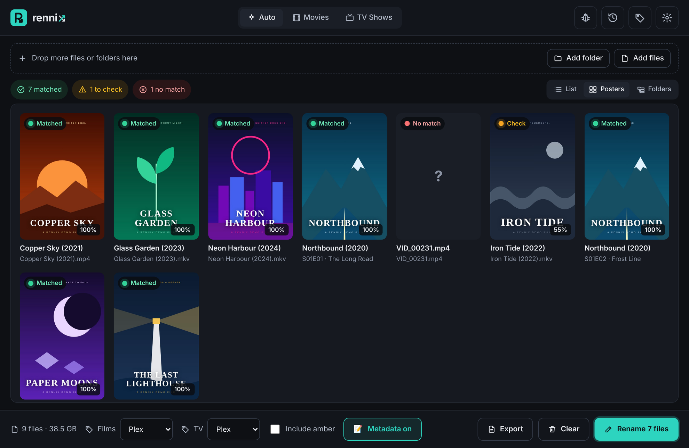
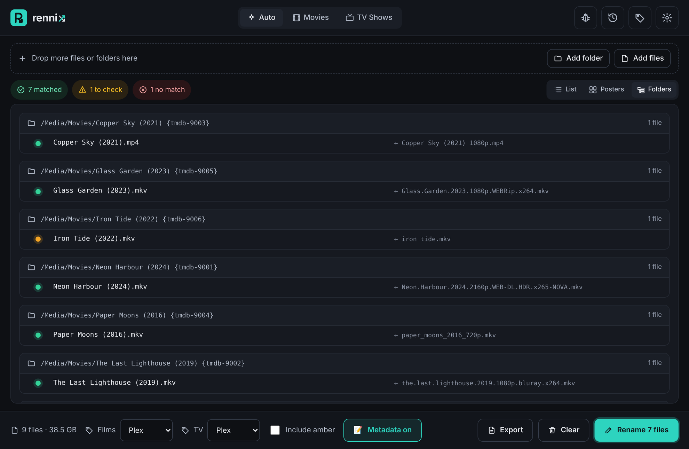
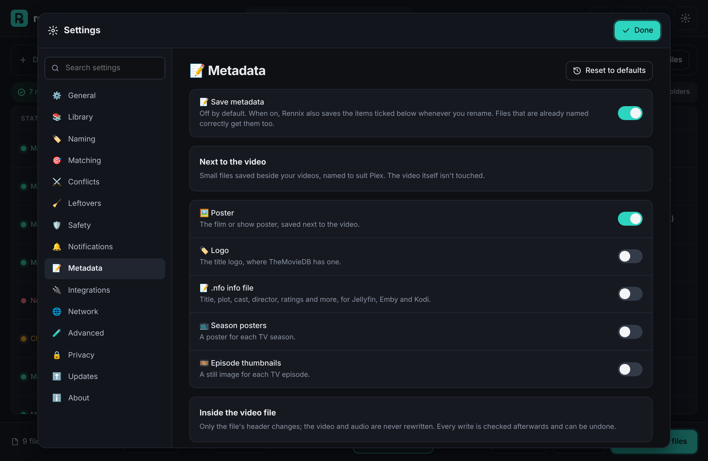
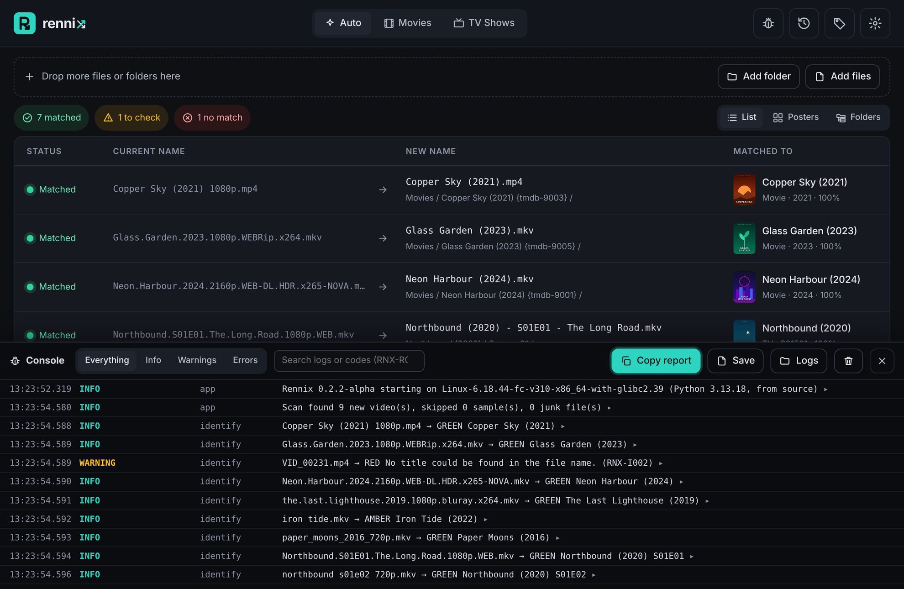

<div align="center">


### Messy folders in. Perfect library out.

Drop in a folder of badly named films and episodes. Rennix works out what every file is,<br>
shows you the new names, and sorts your whole library in one click. Nothing changes until you've checked, and everything can be undone.

<a href="https://github.com/FiTH-g1gGLe/Rennix/releases/latest"></a>
&nbsp;
<a href="https://github.com/FiTH-g1gGLe/Rennix/releases/latest"></a>

[](https://github.com/FiTH-g1gGLe/Rennix/releases)
[](https://github.com/FiTH-g1gGLe/Rennix/releases)
[](https://github.com/FiTH-g1gGLe/Rennix/actions/workflows/build.yml)
[](LICENSE)
[](https://github.com/FiTH-g1gGLe/Rennix/releases/latest)
[](https://www.themoviedb.org/)



</div>

> [!NOTE]
> Rennix is in **early alpha**. It's being tested on real libraries before the first stable release, so please try it on **copies** of your files first.

## ✨ Highlights

- 🎯 **Matching you can trust.** Reads messy scene names, folders, IDs and `.nfo` files, then checks every match against [TheMovieDB](https://www.themoviedb.org/) using the year, runtime and episode titles. Remakes like *Dune* (1984 and 2021) are caught, not guessed.
- 🚦 **Honest confidence.** Green when it's sure, amber when it wants you to look, red when it can't tell. Hover any file to see why.
- 🏷️ **Names your media server loves.** Plex, Jellyfin, Emby and Kodi templates built in, or design your own with a live preview.
- 📝 **Posters, `.nfo` files and tags.** Optional metadata saved next to your files, or written safely inside MKV and MP4 files.
- ↩️ **Undo anything.** Every batch is kept in History and reversed in one click. A crash journal means a power cut never leaves files half-done.
- 🆓 **Free, no account.** Open source, no sign-up, no adverts, and TheMovieDB access is built in.

<details>
<summary><b>See every feature</b></summary>

| | |
| --- | --- |
| 👆 **Manual override** | Change any match, search with posters, and Rennix remembers your choice next time |
| 👀 **Quick preview** | Rest the mouse on a file to see its poster, plot, runtime, rating, why it matched and exactly where it will go |
| 🖼️ **Three views** | A detailed list, a poster wall to spot wrong matches at a glance, and a folder view of your library-to-be |
| 💬 **Brings the extras along** | Subtitles, posters and `.nfo` files are renamed with their video |
| 🔗 **Move, copy or hardlink** | Hardlinks give your library proper names while downloads keep seeding, using no extra space |
| ⚔️ **Never overwrites** | Name clashes are skipped, numbered, or replaced only by a higher-quality copy (the old one goes to the Recycle Bin) |
| 📺 **TV done properly** | Double episodes, specials, anime numbering and daily shows by air date |
| 🧹 **Tidies up** | Empty folders removed, and sample files and junk can be left, gathered up or recycled |
| 🐞 **Clear error codes** | A built-in console logs everything; every problem has a code like `RNX-R001` with a plain explanation, and one click copies a report |
| 🌓 **Looks after you** | Dark and light themes, text size, reduced motion, and a tooltip on everything |
| ⬆️ **Stays up to date** | Tells you when a new version is out; the installer updates over the top and keeps your settings |

</details>

## 📸 Screenshots

<table>
  <tr>
    <td width="50%"></td>
    <td width="50%"></td>
  </tr>
  <tr>
    <td align="center"><b>👀 Hover any file for a quick preview</b></td>
    <td align="center"><b>🖼️ Poster wall: spot wrong matches at a glance</b></td>
  </tr>
  <tr>
    <td></td>
    <td></td>
  </tr>
  <tr>
    <td align="center"><b>👆 Not sure? Pick the right one with posters</b></td>
    <td align="center"><b>📁 See your library before anything moves</b></td>
  </tr>
  <tr>
    <td></td>
    <td></td>
  </tr>
  <tr>
    <td align="center"><b>🏷️ Build your own naming format</b></td>
    <td align="center"><b>📝 Choose exactly which metadata to save</b></td>
  </tr>
  <tr>
    <td></td>
    <td></td>
  </tr>
  <tr>
    <td align="center"><b>📚 Library folders, hardlinks and more</b></td>
    <td align="center"><b>🐞 Console with clear error codes</b></td>
  </tr>
</table>

<sub>The films in these pictures are made up, with artwork drawn for this page.</sub>

## 📥 Download

| Version | Best for |
| --- | --- |
| [**Rennix Setup** (.exe)](https://github.com/FiTH-g1gGLe/Rennix/releases/latest) | Most people. Installs for your user only, no admin rights needed |
| [**Portable** (.zip)](https://github.com/FiTH-g1gGLe/Rennix/releases/latest) | Running from a USB stick or without installing. Keeps its settings beside the app |

> [!TIP]
> Windows may show **"Windows protected your PC"** for new apps. Click **More info → Run anyway**.

Works on Windows 10 and 11. Mac and Linux builds are planned; until then the code runs on them from source (see below).

## 🚀 How it works

1. **Drop** files or folders onto the window
2. **Check** the preview: green rows are ready, amber rows need a quick look, red rows need a manual match
3. **Rename** with one click, and undo from History if you change your mind

| Before | After (Plex template) |
| --- | --- |
| `The.Matrix.1999.1080p.BluRay.x264-GROUP.mkv` | `The Matrix (1999) {tmdb-603}/The Matrix (1999).mkv` |
| `breaking bad s02e05 720p.mkv` | `Breaking Bad (2008)/Season 02/Breaking Bad (2008) - S02E05 - Breakage.mkv` |
| `the.office.us.s03e01e02.mkv` | `The Office (2005)/Season 03/The Office (2005) - S03E01-E02 - Gay Witch Hunt & The Convention.mkv` |
| `Dune.2021.2160p.UHD.BluRay.x265.mkv` | `Dune (2021) {tmdb-438631}/Dune (2021).mkv` |

## 📝 Metadata

Turn on **📝 Metadata** in the bottom bar (or **Settings → Metadata**) and Rennix saves details alongside every rename. Files that are already named correctly get them too, without being renamed. Every item has its own switch, and it's all off until you turn it on.

| | Item | Plex | Jellyfin · Emby · Kodi |
| --- | --- | :---: | :---: |
| **Next to the video** | 🖼️ Poster | ✅ | ✅ |
| | 🏷️ Logo | ✅ | ✅ |
| | 📝 `.nfo` file (plot, cast, director, ratings, IDs) | ➖ Plex ignores these | ✅ |
| | 📺 Season posters | ✅ | ✅ |
| | 🎞️ Episode thumbnails | ✅ | ✅ |
| **Inside the file** | 🏷️ Tags (title, year, plot, genres, director, cast, age rating) | MP4 only | ✅ |
| | 🖼️ Embedded cover | ➖ | ✅ |

Artwork is named the way each media server expects. Existing posters and `.nfo` files are kept unless you turn on **Replace existing**, and Undo removes everything Rennix saved.

> [!TIP]
> **Plex users:** turn on **Use local assets** in your library's settings so Plex picks up the posters and logos.

<details>
<summary><b>How tags are written without risking your files</b></summary>

Rennix uses [mkvpropedit](https://mkvtoolnix.download/) for MKV and [mutagen](https://mutagen.readthedocs.io/) for MP4. Both change only the file's header, never the video or audio.

- **Before:** the file type is checked from its contents, damaged or half-downloaded files are refused, files in use or hardlinked elsewhere are skipped, and the exact bytes that may change are backed up. A fingerprint of the video data is taken.
- **After:** the file is read again; the tracks, running time and sampled video data must match byte for byte, and the tags must read back as written. If anything is off, the file is put back exactly as it was.
- **MP4s are never shifted in place.** If new tags don't fit, Rennix writes to a copy, checks it, and swaps it in.
- **Maximum safety** in Settings always uses a checked copy, for every file.
- **Crashes and undo:** an interrupted write is repaired on the next start, and Undo restores the original tags exactly.

All of this is tested on Windows, Mac and Linux with real MKV and MP4 files, including tests that kill Rennix in the middle of writing.

</details>

> [!NOTE]
> Windows Explorer's **Properties → Details** only shows the title for MKV files. The other tags are there (VLC, MediaInfo and media servers read them), and free add-ons such as Icaros can show more in Explorer.

## 💚 Why Rennix?

Rennix was inspired by [FileBot](https://www.filebot.net/), which many people used for years and which is now paid software. Rennix aims to be the friendly, free option:

- **Free and open source**, with no account, licence key or adverts
- **Preview first, undo always**: nothing changes until you press Rename, and every batch can be reversed
- **Honest about doubt**: unsure matches are flagged for you instead of being renamed wrongly
- **Safe by design**: same-drive moves only change the name; cross-drive moves are copied and checked before the original is removed
- **Friendly**: a clean interface with tooltips everywhere and plain-English messages, no scripting required

## 🗺️ Roadmap

- [x] Identification engine, naming templates and custom formats
- [x] Safe renaming with crash journal and undo
- [x] Windows installer, portable version and update check
- [x] Quick preview, poster wall and folder views
- [x] Console with error codes and one-click support reports
- [x] **Version 2:** posters, logos, `.nfo` files and tags inside MKV and MP4 files
- [ ] Real-world testing and fixes *(in progress)*
- [ ] Artwork picker and a per-file metadata preview
- [ ] File fingerprinting for badly named files
- [ ] Library health check, watch folders, Plex and Jellyfin refresh
- [ ] Mac and Linux builds

Got an idea? [Suggest a feature](https://github.com/FiTH-g1gGLe/Rennix/issues/new?template=feature_request.yml).

## ❓ FAQ

<details>
<summary><b>Is it really free?</b></summary>

Yes. Rennix is free and open source under the MIT licence. There's no paid version, no account and no adverts.
</details>

<details>
<summary><b>Which files does it work with?</b></summary>

Video files: MKV, MP4, M4V, AVI, MOV, WMV, MPG, TS, M2TS, WebM and more. Subtitles (SRT, ASS, SUB, VTT…), posters and `.nfo` files beside them are renamed along with their video. Tags inside the file can be written for MKV and MP4.
</details>

<details>
<summary><b>Will it mess up my Plex (or Jellyfin, Emby, Kodi) library?</b></summary>

Rennix names files the way your media server recommends, including the TheMovieDB ID for a perfect match. Nothing changes until you've checked the preview, and if you don't like the result, Undo puts every file back exactly where it was. Try it on a few files first to get a feel for it.
</details>

<details>
<summary><b>Does it change the video files themselves?</b></summary>

Not unless you ask it to. Renaming only changes names and locations; moves between drives are copied, size-checked, and only then is the original removed. Writing tags inside files is optional and off by default; see **How tags are written without risking your files** above.
</details>

<details>
<summary><b>Where does Rennix keep its data?</b></summary>

Settings and your custom formats are in `%APPDATA%\Rennix`; the match cache, undo history and logs are in `%LOCALAPPDATA%\Rennix`. The portable version keeps everything in a `data` folder beside the app. Nothing is ever stored in Temp.
</details>

<details>
<summary><b>Do I need a TheMovieDB account?</b></summary>

No. Rennix has its own key built in. You can add your own in **Settings → Matching** if you ever want to.
</details>

<details>
<summary><b>Does Rennix send any data about me?</b></summary>

No. It only looks up titles on TheMovieDB and checks GitHub for updates. Nothing about you or your files is collected.
</details>

<details>
<summary><b>Something went wrong. How do I report it?</b></summary>

Open the 🐞 console (top right, or **Ctrl + Shift + L**), click **Copy report**, and paste it into a [bug report](https://github.com/FiTH-g1gGLe/Rennix/issues/new?template=bug_report.yml). The report includes the error codes and log, with your TheMovieDB key hidden.
</details>

## 🛠️ For developers

> You **don't** need any of this to use Rennix. Just [download it](https://github.com/FiTH-g1gGLe/Rennix/releases/latest) and double-click.

You need Python 3.11 or newer.

```bash
git clone https://github.com/FiTH-g1gGLe/Rennix.git
cd Rennix
pip install -r requirements.txt
python run_rennix.py
```

Run the tests with `python -m pytest`. Every push is tested on Windows, Mac and Linux, and Windows builds are produced automatically by [GitHub Actions](https://github.com/FiTH-g1gGLe/Rennix/actions). See [CONTRIBUTING.md](CONTRIBUTING.md) to get involved.

<details>
<summary><b>Project layout</b></summary>

| Path | What it is |
| --- | --- |
| `rennix/parse.py` | Reads titles, years, episodes and quality from file names |
| `rennix/identify.py` | The identification engine: evidence, search tiers, validation and scoring |
| `rennix/tmdb.py` | TheMovieDB client with caching and retries |
| `rennix/naming.py` | Templates, the custom format language and safe file names |
| `rennix/renamer.py` | Planning, the crash journal, renaming and undo |
| `rennix/metadata.py` | Details, artwork, `.nfo` files and where they go for each media server |
| `rennix/embed.py` | Safe tag writing inside MKV and MP4 files, with backups, checks and undo |
| `rennix/ebml.py`, `rennix/mp4box.py` | Read-only MKV and MP4 structure readers used for those checks |
| `rennix/api.py` | The bridge between the window and the engine |
| `rennix/ui/` | The interface (HTML, CSS and JavaScript) |
| `tests/` | 360+ automated tests, including real MKV and MP4 files and "pull the plug" crash tests |
</details>

## 🙏 Credits

- Film and TV data from [TheMovieDB](https://www.themoviedb.org/). This product uses the TMDB API but is not endorsed or certified by TMDB.
- MKV tags are written with `mkvpropedit` from [MKVToolNix](https://mkvtoolnix.download/) by Moritz Bunkus (GNU GPL v2), included in the Windows version.
- File name parsing helped by [guessit](https://github.com/guessit-io/guessit), runtimes read with [MediaInfo](https://mediaarea.net/en/MediaInfo), MP4 tags with [mutagen](https://github.com/quodlibet/mutagen), and the window by [pywebview](https://pywebview.flowrl.com/).

## 📄 Licence

Rennix is released under the [MIT Licence](LICENSE).

---

<div align="center">

**Messy folders in. Perfect library out.**

💡 Inspired by FileBot &nbsp;·&nbsp; 🎬 Directed by g1gGLe &nbsp;·&nbsp; ⌨️ Built by Claude

<sub>If Rennix tidied up your library, a ⭐ on GitHub helps other people find it.</sub>

</div>
