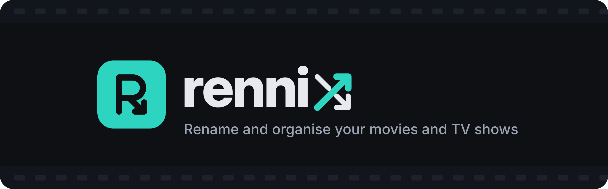
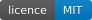
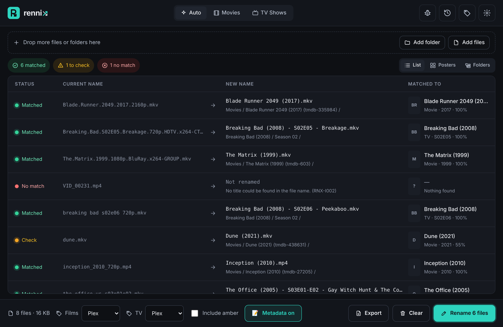
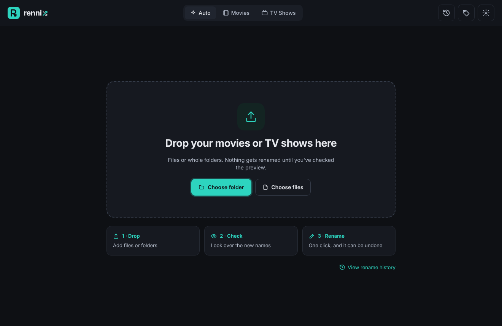
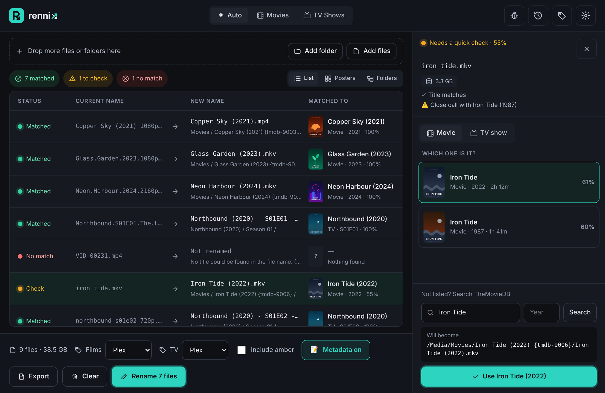
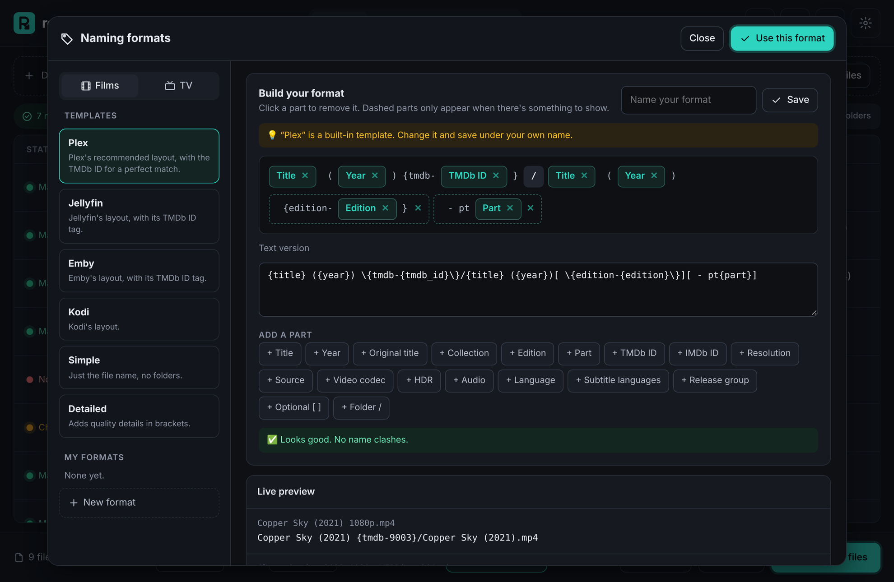
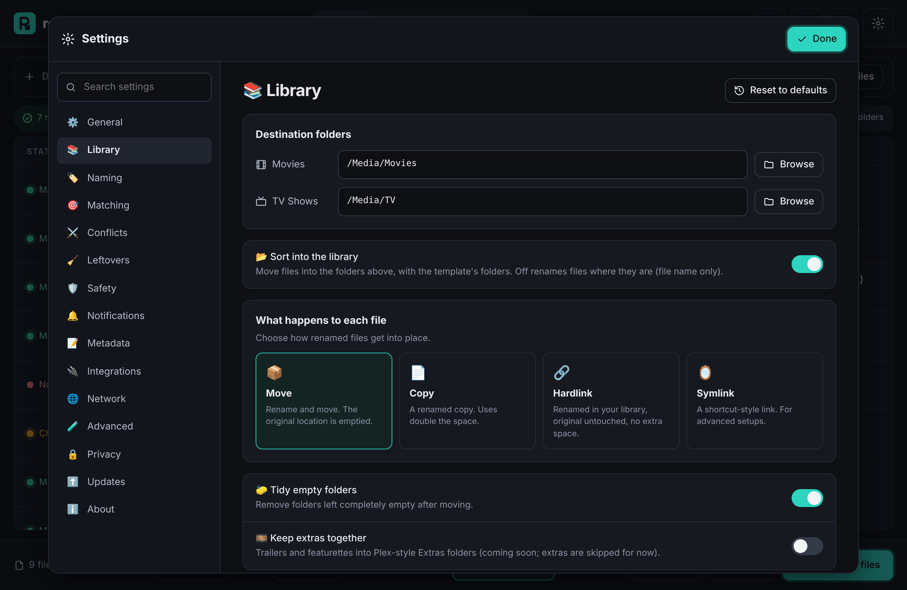

<div align="center">



<br>

Drop in a messy folder. Rennix works out what every file is, shows you the new names, and sorts everything in one click.
Nothing changes until you've checked the preview, and every rename can be undone.

<a href="https://github.com/FiTH-g1gGLe/Rennix/releases/latest"></a>
&nbsp;
<a href="https://github.com/FiTH-g1gGLe/Rennix/releases/latest"></a>

[](https://github.com/FiTH-g1gGLe/Rennix/actions/workflows/build.yml)
[](https://github.com/FiTH-g1gGLe/Rennix/releases)
[](https://github.com/FiTH-g1gGLe/Rennix/releases)
[](LICENSE)
[](https://www.python.org/)
[](https://www.themoviedb.org/)



</div>

> [!NOTE]
> Rennix is in **early alpha**. It's being tested on real libraries before the first stable release. Try it on **copies** of your files first.

## ✨ Features

| | |
| --- | --- |
| 🎯 **Smart matching** | Reads messy scene names, folders, IDs and `.nfo` files, then checks every match against [TheMovieDB](https://www.themoviedb.org/) using the year, runtime, episode numbers and episode titles |
| 🚦 **Honest confidence** | Green when it's sure, amber when it wants you to check, red when it can't tell. Hover any row to see why |
| 🛡️ **Never guesses silently** | Remakes like *Dune* (1984 vs 2021) and *The Office* (US vs UK) are caught, not renamed wrongly |
| 👆 **Manual override** | Change any match, search with posters, and Rennix remembers your choice next time |
| 🏷️ **Naming templates** | Plex, Jellyfin, Emby and Kodi out of the box, or build your own with a live preview |
| 💬 **Brings the extras along** | Subtitles, posters and `.nfo` files are renamed with their video |
| 🔗 **Move, copy or hardlink** | Hardlinks give your library proper names while your downloads keep seeding, using no extra space |
| ↩️ **Undo anything** | Every batch is kept in History and can be reversed in one click |
| 💥 **Crash-safe** | A rename journal means a crash or power cut never leaves files half-renamed |
| 📺 **TV done properly** | Double episodes, specials, anime numbering and daily shows by air date |

## 📸 Screenshots

<table>
  <tr>
    <td></td>
    <td></td>
  </tr>
  <tr>
    <td align="center"><b>Drop a folder to start</b></td>
    <td align="center"><b>Pick the right match when Rennix isn't sure</b></td>
  </tr>
  <tr>
    <td></td>
    <td></td>
  </tr>
  <tr>
    <td align="center"><b>Build your own naming format</b></td>
    <td align="center"><b>Library folders, hardlinks and more</b></td>
  </tr>
</table>

## 📥 Download

| Version | Best for |
| --- | --- |
| [**Rennix Setup** (.exe)](https://github.com/FiTH-g1gGLe/Rennix/releases/latest) | Most people. Installs for your user only, no admin rights needed |
| [**Portable** (.zip)](https://github.com/FiTH-g1gGLe/Rennix/releases/latest) | Running from a USB stick or without installing. Keeps its settings beside the app |

> [!TIP]
> Windows may show **"Windows protected your PC"** for new apps. Click **More info → Run anyway**.

Mac and Linux builds are planned. Until then, run from source (below); the code is fully cross-platform.

## 🚀 How it works

1. **Drop** files or folders onto the window
2. **Check** the preview: green rows are ready, amber rows need a quick look, red rows need a manual match
3. **Rename** with one click, and undo from History if you change your mind

### Example names

| Before | After (Plex template) |
| --- | --- |
| `The.Matrix.1999.1080p.BluRay.x264-GROUP.mkv` | `The Matrix (1999) {tmdb-603}/The Matrix (1999).mkv` |
| `breaking bad s02e05 720p.mkv` | `Breaking Bad (2008)/Season 02/Breaking Bad (2008) - S02E05 - Breakage.mkv` |
| `the.office.us.s03e01e02.mkv` | `The Office (2005)/Season 03/The Office (2005) - S03E01-E02 - Gay Witch Hunt & The Convention.mkv` |
| `Dune.2021.2160p.UHD.BluRay.x265.mkv` | `Dune (2021) {tmdb-438631}/Dune (2021).mkv` |

## 🗺️ Roadmap

- [x] Identification engine, naming templates and custom formats
- [x] Safe renaming with crash journal and undo
- [x] Windows installer and portable builds
- [ ] Real-world testing and fixes *(in progress)*
- [ ] File fingerprinting for badly named files
- [ ] **Version 2:** write cast, director, plot and posters into files and `.nfo` files
- [ ] Library health check, watch folders, Plex and Jellyfin refresh
- [ ] Mac and Linux builds

## ❓ FAQ

<details>
<summary><b>Where does Rennix keep its data?</b></summary>

Settings and your custom formats are in `%APPDATA%\Rennix`; the match cache, undo history and logs are in `%LOCALAPPDATA%\Rennix`. The portable version keeps everything in a `data` folder beside the app. Nothing is ever stored in Temp.
</details>

<details>
<summary><b>Does it change the video files themselves?</b></summary>

No. Version 1 only changes names and locations. Moves between drives are copied, size-checked, and only then is the original removed.
</details>

<details>
<summary><b>Do I need a TheMovieDB account?</b></summary>

No. Rennix has its own key built in. You can add your own in **Settings → Matching** if you ever want to.
</details>

<details>
<summary><b>Does Rennix send any data about me?</b></summary>

No. It only looks up titles on TheMovieDB and checks GitHub for updates. Nothing about you or your files is collected.
</details>

## 🛠️ For developers: running from source

> You **don't** need any of this to use Rennix. Just [download it](https://github.com/FiTH-g1gGLe/Rennix/releases/latest) and double-click.

This section is for people who want to change the code. You need Python 3.11 or newer.

```bash
git clone https://github.com/FiTH-g1gGLe/Rennix.git
cd Rennix
pip install -r requirements.txt
python run_rennix.py
```

Run the tests with `python -m pytest`. Every push is tested on Windows, Mac and Linux, and Windows builds are produced automatically by [GitHub Actions](https://github.com/FiTH-g1gGLe/Rennix/actions).

<details>
<summary><b>Project layout</b></summary>

| Path | What it is |
| --- | --- |
| `rennix/parse.py` | Reads titles, years, episodes and quality from file names |
| `rennix/identify.py` | The identification engine: evidence, search tiers, validation and scoring |
| `rennix/tmdb.py` | TheMovieDB client with caching and retries |
| `rennix/naming.py` | Templates, the custom format language and safe file names |
| `rennix/renamer.py` | Planning, the crash journal, renaming and undo |
| `rennix/api.py` | The bridge between the window and the engine |
| `rennix/ui/` | The interface (HTML, CSS and JavaScript) |
| `tests/` | 300+ automated tests using an offline copy of TheMovieDB data |
</details>

## 🙏 Credits

This product uses the TMDB API but is not endorsed or certified by TMDB.

## 📄 Licence

Rennix is released under the [MIT Licence](LICENSE).
